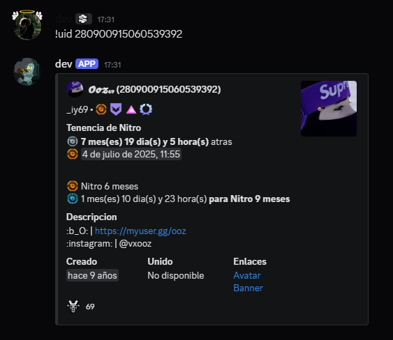

# UID — Discord User Information

<p align="center">


</p>

<p align="center">

<strong>A more complete way to explore Discord profiles.</strong>

<br>
View user information, badges, Nitro, and visuals on their profiles.

</p> </p>

<p align="center"> 
 
 
 

</p>

---

## Preview

<p align="center"> 

</p>

## Characteristics

- **User Information:** consult public profile information.
- **Discord Badges:** Displays available badges.

- **Nitro Statistics:** Information about Nitro seniority and levels.

- **Profile Decorations:** Displays decorations and visual elements.

- **Profile Effects:** Information about profile effects.

- **Nameplates:** Displays nameplates.

- **Server Information:** Information about seniority within the server when available.

- **Flexible Prefixes:** Different prefixes to execute the command.

## Command

| Command | Description |

---|---|

`!uid` | View your own profile |

`!uid @user` | View another user's profile |

`!uid ID` | View by user ID |

**Available Prefixes:** `!`, `,,`, `$`, `,`

## Installation

### Requirements

- Node.js 18 or higher.

- npm.

- A configured Discord application.

### 1. Clone the repository

```bash
git clone https://github.com/LittleKingPlaysHN/uid.git
cd uid
```

### 2. Install dependencies

```bash
npm install
```

### 3. Configuration

Configure credentials using environment variables. Do not publish tokens or credentials to the repository.

### 4. Getting Started

```bash
npm start
```

## Technologies

- Node.js
- discord.js
- discord.js-selfbot-v13
- node-fetch

## Testing

The project requires automated testing to verify its internal functions.

Recommended tests include:

- Converting milliseconds to readable time.

- Calculating Nitro age.

- Identifying badges.

- Handling profiles without additional information.

- Handling incomplete API responses.

- Validating IDs and command inputs.

## Warnings

**UID is an experimental project in BETA.**

The use of automation through user accounts (selfbots) is prohibited by the Discord Terms of Service and may result in the suspension of the accounts involved.

This repository is provided for educational and experimental purposes. Its functionality is not guaranteed, and its use with personal accounts is not recommended.

## Contributions

Suggestions, bug reports, and improvements are welcome.

1. Fork the repository.

2. Create a branch for your changes.

3. Implement your modifications.

4. Submit a pull request.

## Credits

Developed by **LittleKingPlaysHN**.

- GitHub: https://github.com/LittleKingPlaysHN/uid
- Website: https://tokiio.cat

---

<p align="center">

Made with dedication for the Discord community.

</p>
