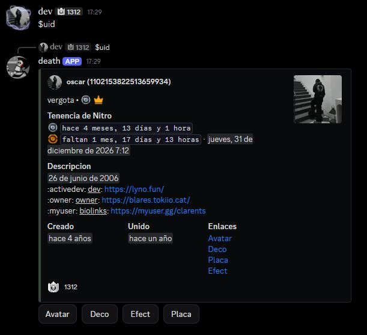
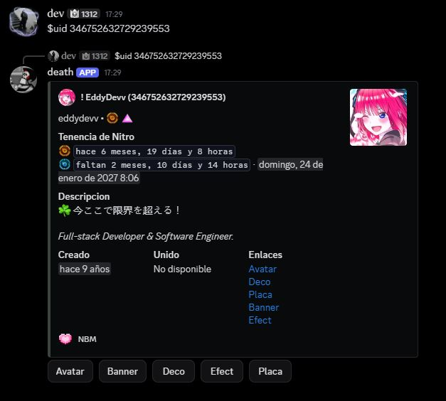
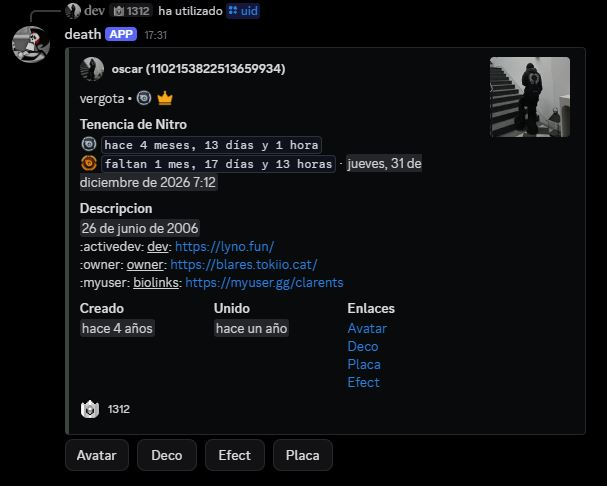

# UID — Discord User Information

> Leer en español → [README.md](./README.md)

<p align="center">
  
</p>

<p align="center">
  <strong>A more complete way to explore Discord profiles.</strong>
  <br>
  Look up user information, badges, Nitro, and the visual elements of their profiles.
</p>

<p align="center">
  
  
  
  
</p>

---

## Preview

<p align="center">
  
  
</p>

## Features

- **User Information:** view public profile information.
- **Discord Badges:** display of available badges.
- **Nitro Statistics:** information about Nitro tenure and tiers.
- **Profile Decorations:** look up decorations and visual elements.
- **Profile Effects:** information about profile effects.
- **Nameplates:** display of nameplates.
- **Server Information:** how long the user has been in the server, when available.
- **Flexible Prefixes:** multiple prefixes to run the command.

## Command

| Command | Description |
|---|---|
| `!uid` | Look up your own profile |
| `!uid @user` | Look up another user's profile |
| `!uid ID` | Look up a profile by user ID |
| `/uid @user` | Look up a profile using slash commands |

**Available prefixes:** `!`, `,,`, `$`, `,`

## Installation

### Requirements

- Node.js 18 or higher.
- npm.
- A configured Discord application.

### 1. Clone the repository

```bash
git clone https://github.com/LittleKingPlaysHN/uid.git
cd uid
```

### 2. Install dependencies

```bash
npm install
```

### 3. Configuration

Set up your credentials through environment variables. Do not publish tokens or credentials in the repository.

### 4. Register /uid

Register the `/uid` slash command. It is only a command definition; `index.js` is what handles the response.

### 5. Start

```bash
npm start
```

## Technologies

- Node.js
- discord.js
- discord.js-selfbot-v13
- node-fetch

## Testing

The project needs automated tests to verify its internal functions.

Recommended tests include:

- Converting milliseconds to readable time.
- Calculating Nitro tenure.
- Identifying badges.
- Handling profiles with no additional information.
- Handling incomplete API responses.
- Validating IDs and command input.

## Warnings

**UID is an experimental project in BETA.**

Automating user accounts (selfbots) is prohibited by Discord's Terms of Service and may result in the suspension of the accounts involved.

This repository is provided for educational and experimental purposes. Its operation is not guaranteed, and using it with personal accounts is not recommended.

## Contributing

Suggestions, bug reports, and improvements are welcome.

1. Fork the repository.
2. Create a branch for your changes.
3. Make your modifications.
4. Submit a Pull Request.

## Credits

Developed by **LittleKingPlaysHN**.

- GitHub: https://github.com/LittleKingPlaysHN/uid
- Website: https://tokiio.cat

---

<p align="center">
  Made with dedication for the Discord community.
</p>
