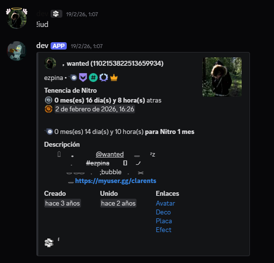
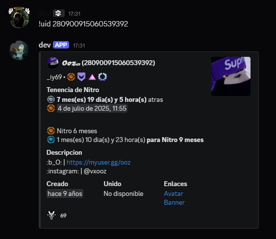

# UID — Discord User Information

<p align="center">
  
</p>

<p align="center">
  **Una forma más completa de explorar perfiles de Discord.**
  <br>
  Consulta información de usuarios, insignias, Nitro y elementos visuales de sus perfiles.
</p>

<p align="center">
  
  
  
  
</p>

---

## Preview

<p align="center">
  
</p>

## Características

- **User Information:** consulta información pública de perfiles.
- **Discord Badges:** visualización de insignias disponibles.
- **Nitro Statistics:** información sobre antigüedad y niveles de Nitro.
- **Profile Decorations:** consulta de decoraciones y elementos visuales.
- **Profile Effects:** información sobre efectos de perfil.
- **Nameplates:** visualización de placas de nombre.
- **Server Information:** información de antigüedad dentro del servidor cuando está disponible.
- **Flexible Prefixes:** diferentes prefijos para ejecutar el comando.

## Comando

| Comando | Descripción |
|---|---|
| `!uid` | Consulta tu propio perfil |
| `!uid @usuario` | Consulta el perfil de otro usuario |
| `!uid ID` | Consulta mediante ID de usuario |

**Prefijos disponibles:** `!`, `,,`, `$`, `,`

## Instalación

### Requisitos

- Node.js 18 o superior.
- npm.
- Una aplicación de Discord configurada.

### 1. Clonar el repositorio

```bash
git clone https://github.com/LittleKingPlaysHN/uid.git
cd uid
```

### 2. Instalar dependencias

```bash
npm install
```

### 3. Configuración

Configura las credenciales mediante variables de entorno. No publiques tokens ni credenciales en el repositorio.

### 4. Iniciar

```bash
npm start
```

## Tecnologías

- Node.js
- discord.js
- discord.js-selfbot-v13
- node-fetch

## Testing

El proyecto necesita pruebas automatizadas para verificar sus funciones internas.

Las pruebas recomendadas incluyen:

- Conversión de milisegundos a tiempo legible.
- Cálculo de antigüedad de Nitro.
- Identificación de insignias.
- Manejo de perfiles sin información adicional.
- Tratamiento de respuestas incompletas de la API.
- Validación de IDs y entradas del comando.

## Advertencias

**UID es un proyecto experimental en fase BETA.**

El uso de automatización mediante cuentas de usuario (selfbots) está prohibido por los Términos de Servicio de Discord y puede provocar la suspensión de las cuentas involucradas.

Este repositorio se proporciona con fines educativos y experimentales. No se garantiza su funcionamiento ni se recomienda utilizarlo con cuentas personales.

## Contribuciones

Las sugerencias, reportes de errores y mejoras son bienvenidos.

1. Haz un fork del repositorio.
2. Crea una rama para tus cambios.
3. Realiza tus modificaciones.
4. Envía un Pull Request.

## Créditos

Desarrollado por **LittleKingPlaysHN**.

- GitHub: https://github.com/LittleKingPlaysHN/uid
- Website: https://tokiio.cat

---

<p align="center">
  Hecho con dedicación para la comunidad de Discord.
</p>
